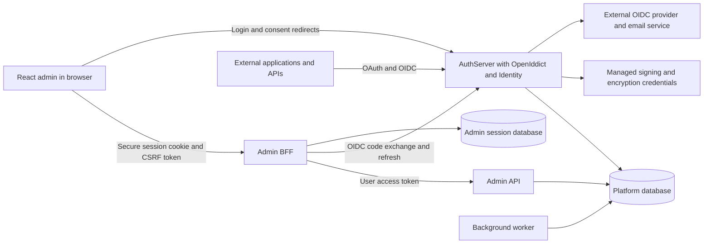

# OpenIddict Vertical Slice Architecture Draft

Use a feature-oriented modular platform with separate web hosts for identity, administration APIs and the administration browser backend. Each project owns complete use cases under Features. Shared projects supply stable contracts, persistence and reusable policy primitives; they do not recreate a central business-service layer.

Status: Proposed architecture for PRD version 0.2, 10 October 2026. Directory trees are design artefacts, not generated projects.

## Runtime boundaries



Each environment selects PostgreSQL or SQL Server. Equivalent support means the platform can run wholly on either provider, not that it writes to both simultaneously. The initial deployment uses one logical platform database with separated schemas or table prefixes. The BFF session database can be another schema/database on the selected provider. This is a coordinated platform, not independently owned microservice databases.

AuthServer owns protocol processing, end-user authentication, consent, token issuance and login sessions. Admin API owns administrative use cases and their authorization. Admin BFF hosts React and implements its backend for frontend: it owns browser sessions and forwards authorized requests with the user's token. The worker executes scheduled configuration checks, email/outbox work and safe cleanup. External applications never call the Admin API for protocol operations.

## Proposed project layout

```text
src/
  IdentityPlatform.AppHost/
    Composition/
  IdentityPlatform.ServiceDefaults/
  IdentityPlatform.DesignTokens/
  IdentityPlatform.AuthServer/
    Features/
      Authorization/Authorize/
      Tokens/Exchange/
      UserInfo/Get/
      Sessions/EndSession/
      Device/Verify/
      Accounts/Login/
      Accounts/Recover/
      Accounts/ManagePasskeys/
      Consent/Decide/
      Federation/Callback/
    Composition/
  IdentityPlatform.Admin.Api/
    Features/
      Applications/Create/
      Applications/Update/
      Applications/RotateSecret/
      Applications/Disable/
      Scopes/Create/
      Audiences/Update/
      Users/Disable/
      Roles/AssignPermission/
      Grants/Revoke/
      Audit/Search/
      ConfigurationIssues/Search/
      Keys/List/
    Composition/
  IdentityPlatform.Admin.Bff/
    Features/
      Sessions/Login/
      Sessions/Callback/
      Sessions/Logout/
      Sessions/GetCurrent/
      Antiforgery/GetToken/
      ApiProxy/Forward/
    Composition/
  IdentityPlatform.Admin.Client/
    src/features/
      applications/create/
      applications/details/
      users/manage/
      scopes/manage/
      grants/revoke/
      audit/search/
    src/app/
    src/shared/ui/
    src/generated/
  IdentityPlatform.Worker/
    Features/
      ConfigurationChecks/Run/
      Tokens/Prune/
      Audit/ApplyRetention/
      Notifications/Deliver/
  IdentityPlatform.Core/
    Features/Applications/
    Features/Identity/
    Features/Scopes/
    Features/Audit/
  IdentityPlatform.Infrastructure/
    Features/Applications/Persistence/
    Features/Identity/Persistence/
    Features/Sessions/Persistence/
    Features/Audit/Persistence/
    Features/Email/
    Persistence/PlatformDbContext/
    Persistence/AdminSessionDbContext/
    Security/KeyProviders/
  IdentityPlatform.Contracts/
    Features/Applications/
    Features/Users/
    Features/Scopes/
  IdentityPlatform.Migrations.PostgreSql/
  IdentityPlatform.Migrations.SqlServer/
  IdentityPlatform.Migrator/
    Features/Database/Upgrade/
    Features/Bootstrap/Initialize/
tests/
  IdentityPlatform.AuthServer.Tests/Features/
  IdentityPlatform.Admin.Api.Tests/Features/
  IdentityPlatform.Admin.Bff.Tests/Features/
  IdentityPlatform.Worker.Tests/Features/
  IdentityPlatform.Migrator.Tests/Features/
  IdentityPlatform.AppHost.Tests/
  IdentityPlatform.Persistence.Tests/Features/
  IdentityPlatform.Architecture.Tests/
  IdentityPlatform.EndToEnd/
docs/
specs/
.specify/
```

Generated migrations, AppHost composition, ServiceDefaults, shared design tokens, React's application shell and generic UI primitives are structural exceptions to Features. Artificial feature folders add no value to generated migrations. Provider projects contain migrations for both database contexts; Migrator is the only production schema-upgrade entry point.

## A slice is a use case

For `Admin.Api/Features/Applications/Create`, keep the endpoint, request validation, handler, mapping and response contract together. A small slice may be one file; split when complexity warrants it. The handler validates product policy, creates an OpenIddict descriptor, calls the application manager and writes a sanitized audit intent in the same transaction. Tests mirror the feature and prove behavior through its public boundary.

The corresponding React feature owns its screen, form schema, mutations and feature-specific components. Generated HTTP types live under `src/generated`; they are transport artefacts and do not become domain entities. The browser never references EF or OpenIddict storage models.

Use direct DI handler invocation initially. A mediator is optional if a demonstrated requirement justifies it. Do not add a generic repository over OpenIddict managers or EF Core, and do not move every handler into a global Services, Commands or Queries project. Reuse manager APIs and stable domain policy, not another feature's private handler. Large shared policies require an explicit owner and tests.

## Dependency rules

| Project | May reference | Must not reference |
| --- | --- | --- |
| Core | BCL and minimal stable abstractions | Web hosts, HTTP context, EF implementations |
| Contracts | Serialization/validation types as needed | EF entities, OpenIddict entities, host handlers |
| Infrastructure | Core, EF Core, Identity stores, OpenIddict stores and infrastructure libraries | Host endpoint/UI projects |
| AuthServer | Core, Infrastructure, ServiceDefaults; DesignTokens build assets | Admin API or React code |
| Admin API | Core, Infrastructure, Contracts, ServiceDefaults | Admin BFF, AuthServer endpoint handlers |
| Admin BFF | Contracts, ServiceDefaults, narrow session persistence registration from Infrastructure; React/design build assets | Admin API handler implementations or direct admin business writes |
| Worker and Migrator | Core, Infrastructure, applicable ServiceDefaults | Browser endpoints |
| Provider migrations | Infrastructure | Other provider's migrations |
| React client | Generated contracts, design tokens and frontend packages | .NET storage/schema details |
| AppHost | Host/resource project metadata and Aspire hosting libraries | Business handlers and production schema writes |
| ServiceDefaults | Telemetry, health and service-discovery abstractions | Product business rules or implicit security-operation retries |
| DesignTokens | Shared semantic CSS/assets and build tooling | Authentication state, tokens or host business logic |

Architecture checks enforce project dependencies, prohibit MVC controller classes in protocol and management hosts, and prevent accidental public sharing of slice internals. Core contains product entities/policies organized by feature, not an enterprise-wide domain model of every protocol concept.

## Persistence ownership and consistency

PlatformDbContext composes ASP.NET Core Identity, OpenIddict EF models and product metadata, audit/outbox and local identity sessions. This allows management mutations to include their audit intent atomically. Use OpenIddict managers for application/scope/authorization/token writes and Identity managers for account writes; EF queries may serve bounded read models. Never write raw token or application tables from controllers, migrations used as business operations, or the React app.

AuthServer has configuration read and identity/token/session write privileges; Admin API has the necessary management privileges; the BFF account has only its own session-store access. Migrator has schema rights via an operator credential. Runtime accounts cannot change schema. The exact database grants must be demonstrated on both providers.

Initially disable OpenIddict entity caching in separately running components with `DisableEntityCaching()` and avoid caching product authorization policy. This prevents an Admin API update remaining invisible in an AuthServer process. Also review any additional token-validation, query and HTTP caches. If performance later requires caches, design cross-process invalidation and retain the five-second enforcement acceptance test before enabling them.

Use portable optimistic-concurrency tokens for product rows and conditional HTTP writes. Do not make SQL Server rowversion the only concurrency strategy. Runtime queries must use matching case and normalization rules on both databases. Protect last-administrator changes with a shared governance concurrency record or equivalent serialized transaction: independently versioned user rows alone do not prevent two administrators from removing each other concurrently. Jobs coordinate with database-backed leases/concurrency checks so two workers cannot execute the same state transition; provider-specific implementation must share behavioral acceptance tests.

## Authentication UI and Minimal APIs

Minimal APIs handle custom protocol endpoints. Razor Pages provide server-rendered login, recovery, consent, device confirmation and profile management screens under feature folders. Configure the Razor view/page conventions explicitly to support that layout; do not assume arbitrary `.cshtml` files are discovered automatically. This keeps authentication form validation and anti-forgery handling close to UI behavior without introducing MVC controllers.

Protocol handling is not moved into Razor Page handlers. A validated protocol request creates a short-lived interaction record; the UI completes the interaction; the browser resumes the corresponding protocol endpoint so OpenIddict validates the request and emits the response. The record is bound to the request, browser interaction and relevant subject, not an arbitrary return URL.

## Admin browser security

The BFF is a confidential OIDC client using code, PKCE and PAR. Prefer `private_key_jwt` for its client authentication using an OpenIddict client integration; prove support in the first approved integration milestone. It maintains durable server-side login tickets and token state. AdminSessionDbContext also holds the OpenIddict client stack's state-token store for callback replay protection, separate from AuthServer's protocol stores. React receives a secure HttpOnly session cookie plus a request-verification token for state-changing calls, never BFF OAuth tokens or BFF client-authentication credentials. Authorized administrators may receive a newly issued managed-application credential once; its response is no-store and the value never persists in browser storage, logs or caches.

Token refresh is coordinated per session with a distributed concurrency guard. All proxy targets and route prefixes are server-configured. Strip browser-supplied bearer credentials and identity headers, inject only the trusted session's access token, and return 401/403 appropriately instead of redirecting an API request to HTML. Logout revokes refresh access as applicable and ends the local session even if the remote logout redirect fails; the UI reports the remaining remote-session consequence accurately.

Admin API validates issuer, audience, lifetime and scope, then current user status and administrative permissions. A role claim in an old token is not sufficient authority after a role change. Automation uses a separate machine identity and narrowly granted policies; it cannot impersonate a human by setting headers.

## Architecture decisions

| ADR | Proposed decision | Reason and tradeoff |
| --- | --- | --- |
| ADR-01 | New OpenIddict backend with adapted UI journeys | Avoid carrying Duende entity semantics into unrelated stores; requires new contracts. |
| ADR-02 | Feature slices inside projects | Keeps validation, execution and tests near the use case; small shared mechanisms still exist. |
| ADR-03 | Minimal API protocol handlers over OpenIddict pass-through | Controllers are unnecessary; application handlers still have substantial security responsibilities. |
| ADR-04 | Three web boundaries plus a worker | Separates issuer exposure and administration; increases deployment and session coordination work. |
| ADR-05 | Shared platform database with manager-owned writes | Enables transactions and online revocation; creates coordinated schema-release requirements. |
| ADR-06 | Durable BFF sessions with tokens held server-side | Limits browser credential exposure; needs protected storage and refresh coordination. |
| ADR-07 | Both SQL Server and PostgreSQL from R1 | Meets user requirement; every persistence change carries a two-provider verification cost. |
| ADR-08 | Signed JWT access tokens and online state validation for the platform API | Interoperable resource-server integration; sensitive claims must be minimized and external revocation limitations documented. |
| ADR-09 | No live entity caches initially | Predictable administrative effect across processes; database performance must meet the stated budget. |
| ADR-10 | Single issuer per deployment | Clear security and key boundaries; does not solve future multi-tenant hosting. |

All ADRs remain proposed until documentation approval. Change an ADR when evidence alters the choice; do not quietly diverge in a feature plan.

## Aspire local development and distributed testing

Add IdentityPlatform.AppHost, IdentityPlatform.ServiceDefaults and IdentityPlatform.AppHost.Tests after approval. AppHost orchestrates the selected SQL Server or PostgreSQL profile, schema/seed job, AuthServer, Admin API, Admin BFF, React development workflow, Worker, local mail sink and controlled OIDC test provider. Aspire is required local/test tooling; this decision does not choose a production hosting platform.

The browser enters through the BFF's HTTPS origin. In development, proxy the React dev assets through that origin or configure a single documented equivalent without moving OAuth tokens into JavaScript. Register exact callback/logout URLs and a consistent canonical issuer across AuthServer, BFF and API. Local certificates must be trusted appropriately; do not disable issuer, audience, TLS or PKCE validation as a testing convenience.

Use Aspire.Hosting.Testing and DistributedApplicationTestingBuilder to build/start the AppHost, wait for actual resource health with bounded cancellation/deadlines, resolve HTTP clients/endpoints, then exercise real service boundaries and dispose the application/resources. Running is not equivalent to ready. Tests use isolated ephemeral databases/volumes and bounded parallelism; development persistent volumes are never reused by CI.

Aspire tests may randomize proxied ports. Resolve the test issuer and callback addresses before configuring clients and keep them consistent for that environment. Never compensate with wildcard redirect URIs or disabled HTTPS checks. AppHost dependency injection does not replace services inside child processes; use host integration tests for those seams and explicit test resource/configuration profiles for distributed tests.

ServiceDefaults centralizes safe telemetry, health and service-discovery conventions with explicit opt-in registration. Do not apply generic HTTP retries to authorization-code exchange, refresh-token rotation, credential changes or other non-idempotent security operations. Fault tests intentionally stop/restart a dependency and prove the expected failure/recovery behavior without retries hiding failures.

CI requires a supported container runtime, image access and enough CPU/memory for each full stack. Record the compatible stable Aspire SDK/packages, runtime and database images at kickoff. Collect sanitized diagnostics on startup failures, enforce timeouts and teardown, and verify both provider profiles locally and in CI. A local dashboard is useful diagnostics and must not expose credentials or become an unauthenticated production management surface.

Primary references: [Aspire test overview](https://github.com/microsoft/aspire.dev/blob/main/src/frontend/src/content/docs/testing/overview.mdx), [first distributed test](https://github.com/microsoft/aspire.dev/blob/main/src/frontend/src/content/docs/testing/write-your-first-test.mdx), [resource access](https://github.com/microsoft/aspire.dev/blob/main/src/frontend/src/content/docs/testing/accessing-resources.mdx), [CI guidance](https://github.com/microsoft/aspire.dev/blob/main/src/frontend/src/content/docs/testing/testing-in-ci.mdx). Pin and validate APIs against the selected release; current documentation is not a substitute for a tested dependency lock.


## Additional architecture decisions

| ADR | Proposed decision | Reason and tradeoff |
| --- | --- | --- |
| ADR-11 | Aspire AppHost and distributed tests for local/CI | Reproducible real process boundaries; requires container resources and exact issuer/callback handling |
| ADR-12 | Explicit API version sets and one generated OpenAPI contract for two UIs | Prevents schema drift; complete tooling compatibility must be verified |
| ADR-13 | Shared semantic tokens across React and Razor | Coherent light/dark product; two rendering stacks still need independent behavior/accessibility tests |
| ADR-14 | Complete feature/boundary traceability and permanent regressions | Testability is designed into slices; coverage numbers alone do not establish correctness |
| ADR-15 | Separate protocol certification, application assessment and organizational assurance | Each claim has distinct scope and evidence; certification is not automatic |

Engineering standards and draft skills/reviewers are defined in the companion governance document. Their activation follows document approval and does not replace deterministic tests or independent assessment. These ADRs share the approval status of ADR-01–10.
