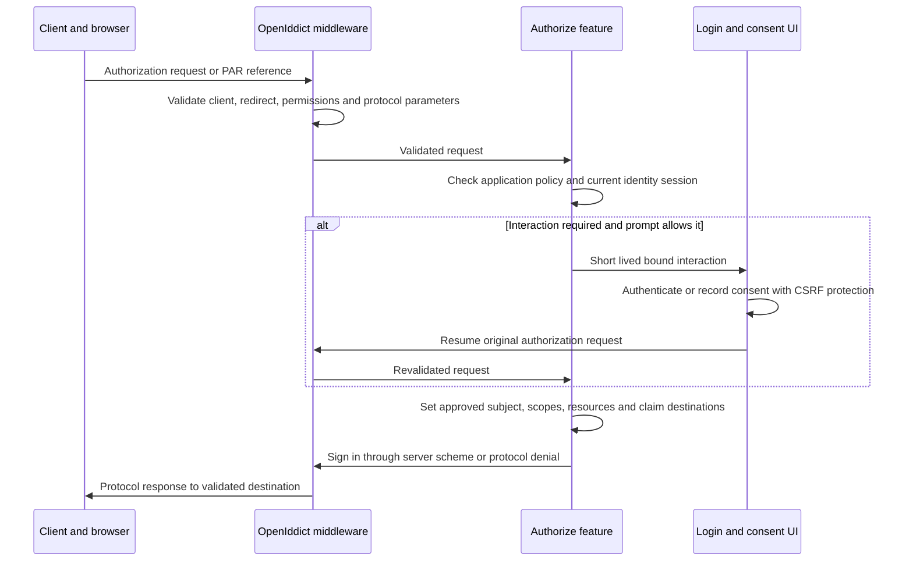

# OpenIddict Minimal API Protocol and Security Design Draft

Minimal APIs can implement the application-owned portions of OpenIddict protocol endpoints. The official ASP.NET Core integration explicitly supports Minimal API handlers. Enable pass-through only where application decisions are needed; retain OpenIddict's request validation, client authentication, token validation, cryptography and response processing.

Status: Proposed design for PRD version 0.2. API names are checked against OpenIddict 7.7.1; no proof of concept or implementation has been built.

## Endpoint ownership

The paths below are selected public contracts. Configure them explicitly and publish discovery from the canonical HTTPS issuer.

| Endpoint | Methods | Owner and behavior |
| --- | --- | --- |
| `/.well-known/openid-configuration` | GET | OpenIddict discovery; no custom Minimal API required |
| `/connect/jwks` | GET | OpenIddict public signing-key publication |
| `/connect/authorize` | GET and POST | OpenIddict validation, then Authorization/Authorize Minimal API for login/consent and principal issuance |
| `/connect/token` | POST form | OpenIddict client/grant validation, then Tokens/Exchange Minimal API for approved grant logic |
| `/connect/userinfo` | GET and POST | OpenIddict server authentication, then UserInfo/Get Minimal API for scope-filtered current user claims |
| `/connect/logout` | GET and POST | OpenIddict end-session validation, then Sessions/EndSession Minimal API with confirmation where required |
| `/connect/par` | POST form | OpenIddict pushed-authorization handling; product eligibility hooks if needed |
| `/connect/introspect` | POST form | OpenIddict handling and registered introspection client authorization |
| `/connect/revoke` | POST form | OpenIddict handling and ownership/client checks |
| `/connect/device` | POST form | OpenIddict device authorization; product eligibility hooks if needed |
| `/connect/verify` | GET and POST | OpenIddict user-code validation, then Device/Verify Minimal API and confirmation UI |
| `/account/*`, `/consent/*` | UI GET and POST | Feature-organized Razor Pages for human interaction; not OAuth JSON endpoints |

Do not invent `EnableIntrospectionEndpointPassthrough`, `EnableRevocationEndpointPassthrough` or equivalent switches for every endpoint. The checked ASP.NET Core builder exposes pass-through for authorization, token, UserInfo, end session and end-user verification. Additional cross-cutting policy belongs in documented OpenIddict event handlers at the appropriate validated-request stage.

Sources: [ASP.NET Core integration](https://documentation.openiddict.com/integrations/aspnet-core.html), [7.7.1 ASP.NET Core builder](https://github.com/openiddict/openiddict-core/blob/7.7.1/src/OpenIddict.Server.AspNetCore/OpenIddictServerAspNetCoreBuilder.cs), [server endpoint configuration](https://github.com/openiddict/openiddict-core/blob/7.7.1/src/OpenIddict.Server/OpenIddictServerBuilder.cs).

## Request pipeline contract

Restore trusted proxy scheme/host information before HTTPS and issuer-dependent logic. Order routing, any narrowly scoped CORS handling, authentication and authorization before executing endpoints. Place anti-forgery handling after authentication/authorization where applicable and ensure browser form handlers actually validate it. Endpoint-scoped rate limiting alone is insufficient if OpenIddict handles a request before endpoint execution: cover library-owned endpoints through an early global/edge policy or appropriate OpenIddict event integration and test it.

Select named authentication schemes deliberately. Browser Identity cookies, BFF cookies, the OpenIddict server scheme and the API validation scheme have different purposes. Protocol route groups must not inherit an admin cookie challenge that redirects token requests to a login page. An anonymous ASP.NET endpoint designation does not bypass OpenIddict's protocol validation.

After pass-through, obtain the parsed validated request using the OpenIddict server context. Do not model-bind a custom JSON token DTO or replace protocol errors with ProblemDetails. A successful issuance uses `Results.SignIn` with the OpenIddict server scheme; this triggers library response handling. A protocol denial uses that scheme and OpenIddict error properties. Local cookie login uses the Identity cookie scheme separately.

All discovery and protocol endpoints need integration tests for malformed requests, unexpected methods/content types, missing authentication, endpoint permissions and middleware ordering. Production requires HTTPS; fix trusted forwarded-header configuration rather than disabling OpenIddict's transport security requirement.

## Authorization and consent state machine

Honor `prompt=none`, `prompt=login`, `prompt=consent`, `max_age`, `auth_time`, requested scopes and consent policy. `prompt=none` must yield a suitable login/consent/interaction error when interaction is required. A login challenge must preserve the validated request using a short-lived bound record; never trust a free-form external return URL. Prevent prompt=login redirect loops by tracking completion of fresh authentication within that interaction.

Resolve the local user and session, enforce disabled/locked/deleted status, require the appropriate authentication strength and calculate consent. Define explicit, implicit-for-first-party, external/preapproved and one-time consent behavior; a UI option must correspond to handler logic. Persist remembered consent through the authorization manager and associate the resulting authorization with the issued principal. Previously granted consent must not silently grant newly added scopes.

Grant only the intersection of requested scopes, application permission, user eligibility and consent. Resolve audiences from the approved scope-resource mapping. Restrict R1 requests to one API audience per authorization unless an approved feature explicitly defines safe multi-audience behavior. Never derive token audiences from an unvalidated client parameter.

Source: [authorization storage](https://documentation.openiddict.com/configuration/authorization-storage.html). These UI/state-machine requirements are application design obligations, not automatic behavior promised by enabling pass-through.

## Token grant responsibilities

| Grant | Feature responsibility after library validation |
| --- | --- |
| Authorization code | Authenticate the code through the server scheme; recheck account, session, application and current policy; preserve validated subject and authorization binding; let OpenIddict enforce code/PKCE/client binding and redemption. |
| Refresh token | Authenticate through the server scheme; recheck current account, session, authorization, application, scope and resource permissions; preserve authentication context; reject scope escalation and rebuild releasable claims. |
| Client credentials | Require an approved confidential machine client; create a machine principal from registration policy, not an end-user login; limit scopes/resources and distinguish machine audit identity. |
| Device code | Authenticate through the server scheme after verified user approval; enforce current identity/application policy and requested-scope limits; preserve polling, expiry and replay semantics from OpenIddict. |
| Anything else | Return the appropriate unsupported-grant response; no password/implicit/hybrid backdoor. |

For the conventional R1 security profile, use rolling refresh tokens with an explicit, tested replay policy. Future FAPI profiles require a different, separately specified policy; this design makes no FAPI claim. Proposed R1 policy is no reuse leeway, serialized refresh in the BFF, and invalidation of the compromised authorization on detected reuse. Verify how the pinned library revokes linked tokens and add narrowly scoped policy only if required. Do not assume a default rotation option delivers the whole product requirement.

Initial configurable lifetimes: authorization code 60 seconds; access token 5 minutes; identity token 5 minutes; absolute refresh lifetime 8 hours for admin and 7 days for approved ordinary applications; admin session idle timeout 30 minutes and absolute timeout 8 hours. User/client policy may shorten these limits. Renewal must not extend an absolute refresh/session deadline. Device and PAR lifetimes/poll intervals must be fixed in the feature plan and tested before release.

## Claims and resources

Define an explicit catalogue mapping scope, user property, consent requirement and token destination. `sub` is a stable opaque user ID; a machine identity uses a disjoint namespace and identity type. Emit email/profile claims only when approved and needed. Include roles/permissions only for the correct audience, and never emit administrator roles to arbitrary clients.

Principal construction must call the applicable scope, resource, authorization and destination helpers. Raw Identity principals contain claims that should never reach tokens. Exclude password hashes, security stamps, authenticator secrets, provider tokens, recovery codes and internal authorization bookkeeping. UserInfo always returns the same subject as the associated token and only scope-permitted claims; machine tokens do not produce invented human profiles.

Sources: [claim destinations](https://documentation.openiddict.com/configuration/claim-destinations.html), [application permissions](https://documentation.openiddict.com/configuration/application-permissions.html), [scope descriptor](https://github.com/openiddict/openiddict-core/blob/7.7.1/src/OpenIddict.Abstractions/Descriptors/OpenIddictScopeDescriptor.cs).

## Token format and revocation contract

Proposed access tokens are asymmetrically signed JWTs with access-token encryption explicitly disabled for resource-server interoperability. This is a deliberate server option, not OpenIddict's default. Keep encryption for authorization codes and refresh tokens, retain signing and encryption credentials, and keep token and authorization storage enabled. ID tokens remain for clients; the Admin API must reject them as API credentials.

Admin API uses remote issuer discovery and asymmetric signing-key validation plus direct access to the platform's OpenIddict stores for token and authorization entry validation. Do not configure `UseLocalServer()` in a separate process and expect it to discover AuthServer configuration. API policy additionally checks the current user/session and application status. Its database dependency fails closed. An expired or revoked token, disabled user or removed permission cannot fall back to trusting stale token claims.

External APIs may use online introspection with an audience-bound confidential registration or validate signed access tokens locally. Offline validation cannot observe revocation immediately. Its exposure window is bounded by access-token expiry and accepted clock skew. State changes therefore have separate effects on local cookies, refresh capability and already issued access tokens; the UI must explain all three.

Sources: [token storage and validation behavior](https://documentation.openiddict.com/configuration/token-storage.html), [token validation integration](https://documentation.openiddict.com/guides/getting-started/implementing-token-validation-in-your-apis.html), [7.7.1 validation builder](https://github.com/openiddict/openiddict-core/blob/7.7.1/src/OpenIddict.Validation/OpenIddictValidationBuilder.cs).

## Logout and browser security

GET may display logout confirmation; it must not make an unvalidated state-changing logout effortless through a cross-site link. Validate protocol hints and post-logout redirects through OpenIddict, use protected confirmation when necessary, end the local Identity session and hand the protocol sign-out response to the server scheme. Local BFF logout is CSRF-protected and ends its server-side ticket and refresh capability.

Use anti-forgery on cookie-authenticated login/consent/device/account and admin state-changing forms. OAuth backchannel requests cannot require a browser anti-forgery token: their protection is protocol/client/token validation. Avoid blanket anti-forgery disablement across the host. CORS origins are not redirect URIs; enforce a separate explicit origin allowlist with no wildcard credentialed CORS. BFF browser API traffic is same-origin by default.

## Product policies outside native storage

OpenIddict application metadata does not by itself enforce product Enabled flags, credential-expiry dates, browser origins, allowed identity providers, administrative roles or scope claim policies. Place such checks in named policy components invoked at the relevant OpenIddict validation/sign-in stages and administrative boundaries. They must cover PAR, authorization, token, device and UserInfo paths where applicable. A disabled client may still need controlled revocation access for cleanup; specify this separately from issuance permission.

## Threat model and controls

| Threat | Required control | Proof |
| --- | --- | --- |
| Redirect manipulation and code interception | Exact registered redirects, PKCE S256, protocol-bound interactions and no open redirect helpers | Wrong redirect/verifier/state tests |
| CSRF and session fixation | Anti-forgery, secure host cookies, session replacement after login/privilege changes | Browser cross-site and cookie tests |
| Browser token theft | Server-side BFF tickets/tokens, CSP, minimal browser state | Storage/network inspection and XSS controls |
| Privilege escalation through stale claims or arbitrary claims | Current permission lookup, reserved-claim protections, recent MFA | Remove permission while session/token remains valid |
| Token replay and audience confusion | Grant binding, replay policy, exact issuer/audience/type validation | Reuse, wrong-audience and ID-token-as-access-token tests |
| Credential and key exposure | Manager hashing, encrypted ticket storage, external private-key storage, log redaction | Secret scanning and key-access tests |
| Account-linking takeover | Bind to validated provider issuer and subject; require proof before linking existing accounts | Email collision and provider substitution tests |
| Federation SSRF | Operator-approved issuer endpoints, outbound restrictions and no user-supplied discovery URLs | Disallowed issuer/discovery tests |
| Administrative races and lost updates | Optimistic concurrency, protected last-admin transition, transactional audit | Concurrent requests against both providers |
| Brute force and resource exhaustion | Login throttling/lockout, token/device rate limits, request/paging bounds | Distributed rate-limit and polling tests |
| Audit tampering or secret leakage | Durable append-only intent, restricted DB role, redaction and restricted export | Mutation/audit atomicity and forbidden-field scans |
| Restored backup reactivates revoked state | Recovery runbook invalidates relevant sessions/grants and addresses restored revocations | Restore drill with a previously revoked credential |

Signing keys, token-encryption keys and ASP.NET Data Protection key rings have separate roles and rotation policies. Back them up securely, share only within the required component boundary, and retain old validation/decryption material for the lifetime of protected artefacts. Development certificates and ephemeral keys are not a production strategy. See [credential guidance](https://documentation.openiddict.com/configuration/encryption-and-signing-credentials.html).

## Protocol assurance boundary

R1 targets OpenID Foundation Basic OP and Config OP, with static client registration and authorization-code query responses. Confirm the current suite's PKCE/PAR and client-authentication setup compatibility in the first approved milestone. Advertise only enabled capabilities; adding form_post requires its applicable tests/profile. Standard protocol paths are not versioned with the Admin API and do not use management Problem Details.

The security/certification companion defines applicable ASVS 5.0.0 Level 3 controls, RFC 9700 and NIST-oriented authentication/federation evidence, independent assessment and submission prerequisites. Test RP-initiated logout in R1; certification for logout is later work because the Foundation requires an additional session/front-channel/back-channel profile. No agent or passing internal test may label the product certified before the external process completes.

Admin BFF protection includes documentation proxies: Scalar/Swagger cannot receive its stored OAuth tokens, and document/asset routes need deliberate access and CSP rules. The OpenAPI documents describe management APIs; OIDC discovery remains the protocol capability contract.
